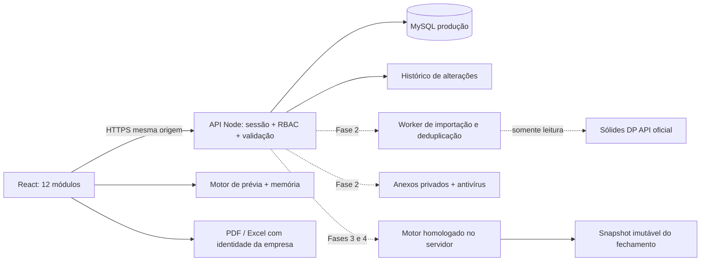
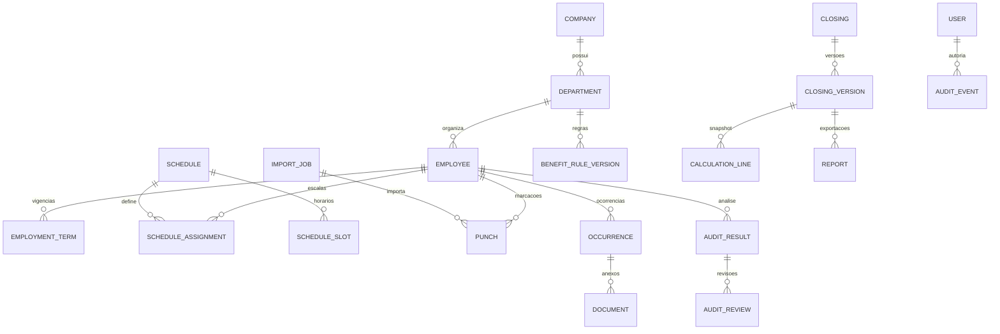

# Arquitetura · DPControl

O schema é evoluído por migrações ordenadas em `server/migrations.mjs`. Cada versão aplicada é registrada na tabela `schema_migrations`; a inicialização executa somente versões pendentes e expõe a versão atual no health check.

Status: base executável com entrega antecipada das interfaces das quatro fases. Sistema interno, uma única organização. Não existe assinatura, faturamento SaaS ou isolamento multitenant.

## Decisões

| Decisão                                      | Motivo / consequência                                                                                                       |
| -------------------------------------------- | --------------------------------------------------------------------------------------------------------------------------- |
| React 19 + TypeScript + Vite                 | Fluxos internos ricos, componentes simples e build independente da API. Sem necessidade de SSR.                             |
| Node 22 + Express 5                          | Uma API própria e um monólito modular; menor custo operacional que microsserviços.                                          |
| MySQL em produção                            | Compatibilidade com a infraestrutura aaPanel existente, relacionamentos e transações. SQLite permanece nos testes locais.   |
| SQL parametrizado                            | Nunca interpolar valores do usuário. A camada db converte placeholders para pg.                                             |
| Cookie opaco de sessão                       | HttpOnly, SameSite Strict, Secure em produção; hash do token no banco, expiração de 8h e revogação por usuário.             |
| Scrypt com salt aleatório                    | Senhas não reversíveis. Não usar localStorage para autenticação.                                                            |
| Núcleo de cálculo puro                       | Testável, sem depender de React. As prévias rodam no cliente; o fechamento oficial deverá recalcular no servidor.           |
| Sem novas infraestruturas de filas na Fase 1 | Na Fase 2 introduzir job persistente/worker e outbox; Redis apenas se volume justificar.                                    |

## Fluxo

## Módulos e responsabilidades

| Módulo / rota                  | Interface entregue                                                                          | Persistência / regra atual                                                        | Evolução                                                                  |
| ------------------------------ | ------------------------------------------------------------------------------------------- | --------------------------------------------------------------------------------- | ------------------------------------------------------------------------- |
| Dashboard `/`                  | Indicadores, gráfico de jornadas, distribuição, pendências, resumo financeiro, filtros      | Dados derivados de cadastros/registros; totais calculados, sem números fabricados | Séries de qualquer período e agregações paginadas no servidor             |
| Funcionários `/funcionarios`   | Tabela, busca, filtros, paginação, detalhe, formulário pessoal/contrato/benefícios          | API validada, CPF, matrícula única, vínculo de departamento, versão otimista      | Histórico temporal de salário/escala, vigência de regras                  |
| Departamentos `/departamentos` | Cards, responsáveis, escala-base, descontos VA/VT e política dominical                      | API, administrador altera regras                                                  | Calendário efetivo e validação das políticas por gênero/escala/CCT        |
| Integração `/integracao`       | Estado honesto, documentação, importação com prévia CSV/XLSX e resultados por linha         | Modelo normalizado de funcionários, pontos e ocorrências                          | Conector oficial, mapeamento nativo, fila, retry, checkpoints             |
| Auditoria `/auditoria`         | Filtros, análise, severidade, detalhe do dia, observação, descarte, conferência e histórico | Motor indicativo + revisão gravada; não altera Sólides                            | Revisão invalidada quando a origem mudar, escala detalhada de 6 marcações |
| Ocorrências `/ocorrencias`     | Cadastro, consulta, edição, origem, período e conferência                                   | API persistente, intervalo válido; chave de deduplicação                          | Anexos privados, sincronização, cancelamento lógico e versionamento       |
| VA `/vale-alimentacao`         | Dias-base/adicionais/descontos/elegíveis, total e memória por pessoa                        | Escala individual, calendário e ocorrências conferidas; regra VA independente     | Quebra de descontos por tipo; override justificado; regra com vigência    |
| VT `/vale-transporte`          | Apuração independente, passagens, tarifa, total e memória                                   | Descontos específicos VT; sem herdar lista VA                                     | Rotas/tarifas múltiplas por dia e regras avançadas                        |
| Noturno `/adicional-noturno`   | Salário, horas reduzidas, percentual, total e memória                                       | Interseção por minutos, virada de dia; exclui jornadas incompletas                | Homologar CCT, DST histórico, prorrogação contínua, múltiplos turnos      |
| Fechamento `/fechamento`       | Etapas, período livre, pendências, consolidação, PDF prévia                                 | Definitivação explicitamente bloqueada na API                                     | Snapshot, transação, aprovação, reabertura e nova versão                  |
| Relatórios `/relatorios`       | 11 tipos em PDF e Excel e filtros                                                           | Identidade empresarial em cabeçalho; planilhas com logo                           | Exportação no servidor por snapshot e log do acesso                       |
| Configurações `/configuracoes` | Empresa/logo, parâmetros, feriados, usuários/perfis, histórico                              | Restrição admin no servidor; consulta não escreve                                 | SMTP, permissões granulares, retenção, backups e chave de integração      |

## Dados atuais

IDs UUID, valores monetários de cadastro em número decimal na API; arredondamento de prévias a centavos. Produção financeira futura deverá usar valores em centavos/NUMERIC e aritmética decimal, nunca somas monetárias binárias como fonte contábil.

Tabelas atuais criadas em `server/db.mjs`:

- `users`: nome, e-mail único, hash, perfil, ativo, criação.
- `sessions`: hash do token, FK usuário, validade.
- `company`: singleton, dados da empresa e parâmetros, versão.
- `departments`: nome único, regras estruturadas, versão.
- `employees`: matrícula única, CPF único quando preenchido, FK departamento, dados estruturados, versão.
- `records`: envelope versionado para pontos, ocorrências e conferências; chave externa única.
- `audit_log`: usuário, ação, entidade, ID, detalhe sem segredo e timestamp.
- `password_resets`: estrutura reservada; fluxo de envio/consumo ainda não implementado.

O campo `data` usa JSON serializado em TEXT, compatível com ambos os bancos. É uma decisão explícita de bootstrap, não o modelo final de dados trabalhistas. A migração para tabelas por domínio deve preservar IDs, versões e chaves, em transação, com comparação de contagens. Não manter dois bancos como fonte simultânea.

## Modelo alvo das Fases 2–4

### Restrições obrigatórias do alvo

- Ponto: UNIQUE(provider, external_id). Preservar payload bruto restrito, hash, horário UTC, data local, zona e origem. Correções chegam como nova versão da origem, nunca por escrita na Sólides.
- Ocorrência: chave externa oficial quando disponível. Fallback de hash é candidato a duplicidade e precisa de confirmação em casos ambíguos.
- Escala: slots ordenados 2/4/6+, vigência, exceções por dia, atravessamento de meia-noite, descanso, calendário efetivo e alterações históricas.
- Regras VA e VT: versões separadas, início/fim, tipos elegíveis, justificativa e aprovador. Sem dias fixos universais por gênero.
- Resultado da auditoria: vincular hash de pontos + versão da escala + motor. Alteração da origem torna a revisão anterior obsoleta.
- Fechamento: UNIQUE(competência, intervalo, departamento, versão). Máquina de estados RASCUNHO → EM_CONFERENCIA → FINALIZADO → REABERTO (nova versão). Snapshot de empresa, regras, cadastros, pontos, ocorrências, cálculo e pendências apresentadas.
- Totais calculados em servidor; cliente nunca decide valor final enviado ao banco. Sem aprovação oculta de pendências.
- Logs: append-only em produção, diff com mascaramento de CPF e sem conteúdo médico, senhas ou tokens; impedir UPDATE/DELETE pela role da aplicação.

## Segurança e privacidade

Controles implementados: RBAC no servidor, sessão opaca/hash, hash scrypt, origem e cabeçalho anti-CSRF, consultas parametrizadas, limites de requisição no login/recuperação, JSON com limite, cabeçalhos Helmet, conflitos de versão, arquivos de ambiente e banco fora do Git.

Controles já operacionais incluem migrações versionadas no MySQL, HTTPS/reverse proxy, expurgo de sessões, recuperação por SMTP com token descartável e criptografia autenticada de segredos. Ainda são necessários storage privado com validação por assinatura e antivírus, política de retenção/documentos, segregação de funções, trilha imutável, backups cifrados e restauração comprovada. A implementação técnica isolada não atesta conformidade integral com LGPD.

## Limites conhecidos

`bootstrap` carrega o conjunto atual inteiro, adequado à validação, não a milhares de funcionários com anos de ponto. Migrar para endpoints paginados e análises em job antes de escala. Cadastro de 6 marcações preserva a quantidade; horários detalhados desses 6 slots ainda precisam de implementação. Descanso dominical configurado é referência para revisão, não gerador de folgas automático. O gráfico do dashboard agrupa as marcações do período selecionado em até sete intervalos; os agregados ainda são calculados no navegador. SQLite é desenvolvimento; não considerar PostgreSQL validado apenas porque o adaptador existe.
